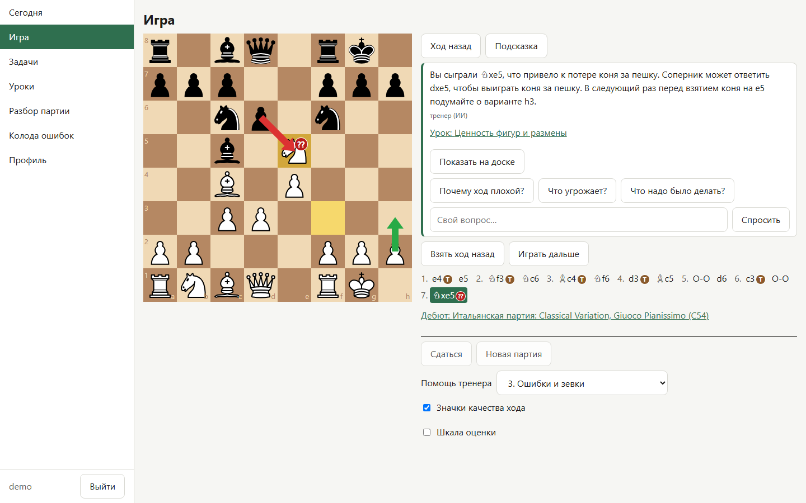
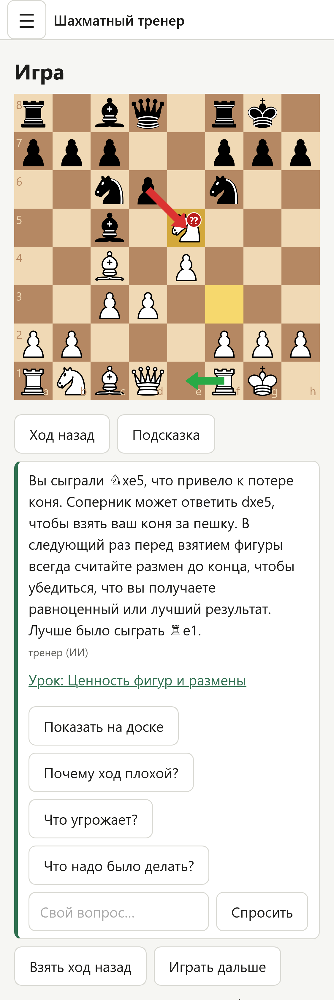
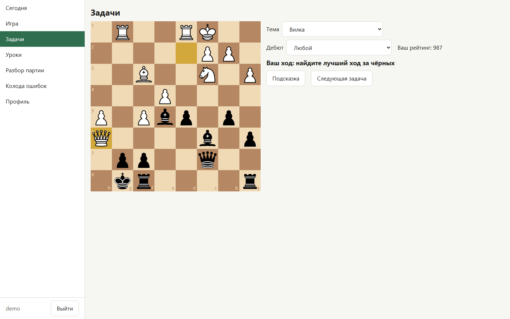
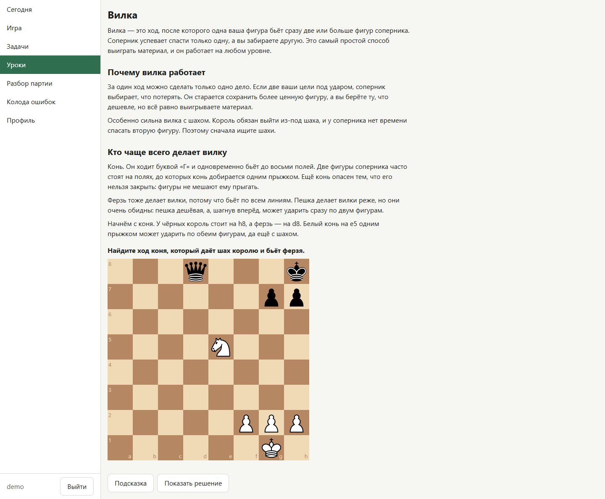
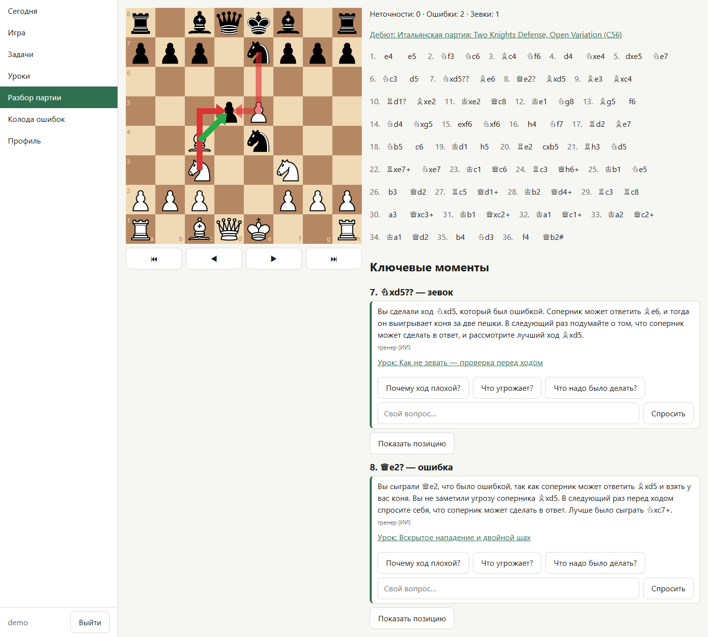
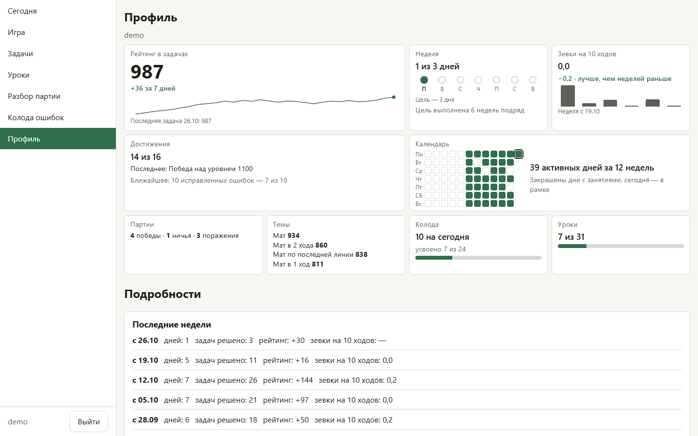
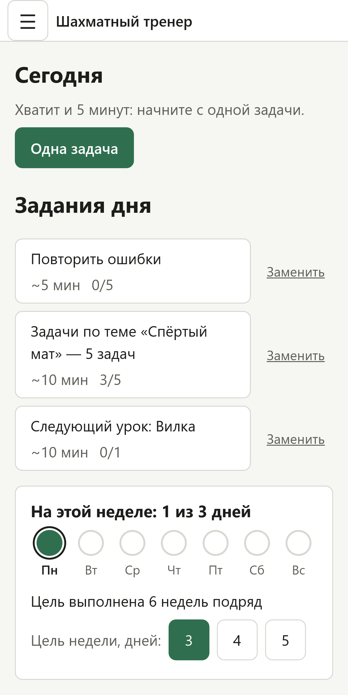
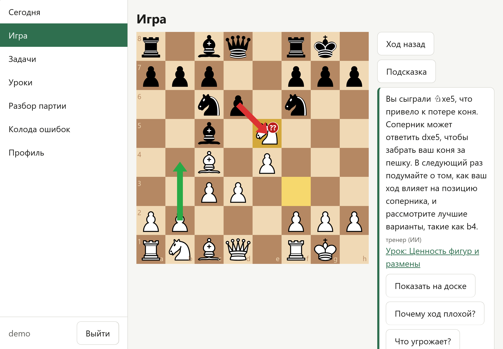

[Русская версия](README.ru.md)

# Chess Coach

Chess Coach is a personal chess trainer for a beginner that runs as a web app on your own computer.
It works offline in your home network, and you can use it from a desktop browser, a phone or a tablet.

**Language.** The interface and the lessons are in Russian now. An English interface is planned.

<p>
  
  
</p>

## Contents

- [How it works](#how-it-works)
- [Features](#features)
- [Requirements](#requirements)
- [Install and run](#install-and-run)
- [First user](#first-user)
- [Configuration](#configuration)
- [LLM coach (optional)](#llm-coach-optional)
- [Senior coach over MCP (optional)](#senior-coach-over-mcp-optional)
- [Phones and tablets](#phones-and-tablets)
- [Autostart](#autostart)
- [Security](#security)
- [Update and backups](#update-and-backups)
- [Development](#development)
- [Credits and licenses](#credits-and-licenses)

## How it works

The chess engine computes. The app renders chess claims from trusted facts and lesson text.

- Stockfish and python-chess compute every chess fact: the evaluation, the best move, the line, a hanging piece, a tactical motif.
- The app renders a short template explanation from the facts. A local language model (LLM) can select an additional study tip from a fixed list.
- In lesson questions, the LLM selects one complete passage from the lesson. It cannot add its own chess claims.
- The validator accepts only known selections. Invalid replies and service failures use the template explanation or report that no lesson answer is available.
- Every type of fact has a template text. The app works fully without the LLM.

## Features

- **Today.** A short training plan with three daily tasks and check marks; you can replace one task a day.
  The five-minute session offers a position from your own game and a new exercise. A basic exercise is available before you have game history.
  You can pause and resume a session. When a delayed check is due, the app looks for a new position.
  Plan themes rotate. Recent results and hints adjust the puzzle target from 3 to 7; themes with few attempts remain provisional.
  A week goal of 3, 4 or 5 active days, and a "One puzzle" button for days with little time.
  After a break of three days or more, the app welcomes you back without a list of missed days.
- **Play.** You play against a human-like opponent: Maia neural networks through lc0, levels 800 to 1900.
  Level 800 is Maia 1100 that plays a random move in a quarter of its moves.
  The coach help has five levels, from "1. Без подсказок" (no hints) to "5. Разбор каждого хода" (explain every move).
  With no hints, the opponent replies independently of coach checks. Hidden comments do not call the LLM;
  move facts and game statistics are retained. Visible explanations and selected warnings can still require a wait.
  A game with takebacks or coach hints is saved as a training game: its result does not count in wins and losses.
- **Puzzles.** About 350,000 puzzles from the Lichess puzzle database, from rating 400 to 2400.
  You get an Elo rating, overall and for each theme. After a wrong move, the coach explains it and shows the solution.
  Unsent results stay on the device and can be retried without changing the rating twice.
- **Lessons.** 31 lessons with interactive positions: from how the pieces move to rook endgames, plus a section on openings.
  A move that the engine rates as equal to the best move counts as correct, and so does any mate.
- **Game review.** Review a saved game or a pasted PGN: marks ?!, ? and ?? on moves, and up to five key moments with explanations.
  Select “Попробовать ход” in a saved game. Stockfish checks your move, then you can step through the solution.
  A click on the opening name opens an opening card with the main line and puzzles for it.
- **Mistakes deck.** Your blunders from games, mistakes from reviews and failed puzzles become cards for spaced repetition.
  The engine checks each answer. Three correct answers in a row mark a learned milestone; later reviews continue at longer intervals.
  The app shows at most 10 reviews a day. Later the plan offers a different puzzle on the same motif as practice, without claiming measured skill transfer.
- **Profile.** Puzzle rating chart, themes from weak to strong, blunders per 10 moves, an activity calendar, 16 achievements and the settings.
  The blunder rate uses saved games with a complete analysis. The profile shows how many games it includes.
- **Model comparison.** A blind test of LLM explanations for the administrator: you see two anonymous texts for one mistake and vote.
  The results table can make a model the default.
- **Admin page.** The administrator creates users, resets their tokens, sees their progress and can revoke their MCP keys.
- **Senior coach.** A language model in an MCP client, for example Claude Code, connects to the app.
  It reviews your games with the app's Stockfish and saves a plan for the Today page.
  The model can run in the cloud: see [Senior coach over MCP](#senior-coach-over-mcp-optional).

Each user has their own progress. Other users do not see it. The administrator sees a summary.

### Screenshots

<table>
  <tr>
    <td></td>
    <td></td>
  </tr>
  <tr>
    <td></td>
    <td></td>
  </tr>
</table>

<table>
  <tr>
    <td></td>
    <td></td>
  </tr>
</table>

## Requirements

- Windows or Linux.
- Python 3.11 or newer.
- Node.js 20.19+ or 22.12+ (the frontend uses Vite 8), with npm.
- git.
- On Linux: g++ and git to build lc0. lc0 has no Linux release binaries, so `setup.py` builds it from source (2–5 minutes).
  Without lc0 the opponent is Stockfish with a limited strength.
- Disk space: about 1.5 GB. The puzzle source files take about 850 MB, the puzzle database about 135 MB, the engines about 145 MB,
  the Python environment about 210 MB and the frontend packages about 150 MB.
  Each Ollama model for the LLM coach takes 2.7–6.6 GB more. `setup.py --dev` also downloads the Playwright browsers.
- Internet access only during the installation and updates. The exception is the senior coach with a cloud model.
- Optional: an NVIDIA GPU with 4–6 GB of video memory for the LLM coach.

### How to get the requirements

Windows:

```powershell
winget install Python.Python.3.12 Git.Git OpenJS.NodeJS.LTS
```

Open a new terminal after the installation.

Linux (Debian or Ubuntu): install Python, git and g++ with the package manager.

```bash
sudo apt install python3 python3-venv git g++
```

Ubuntu 22.04 and older have Python 3.10 or older. Install Python 3.12 with uv, without administrator rights, and start the app with it:

```bash
curl -LsSf https://astral.sh/uv/install.sh | sh
uv python install 3.12
PYTHON=python3.12 ./run.sh
```

If the shell does not find `python3.12`, run `uv python update-shell` and open a new terminal.

Debian 12 and Ubuntu 24.04 have Node.js 18 in apt, which is too old. Install a newer Node.js with nvm, without administrator rights:

1. Install nvm:
   ```bash
   curl -o- https://raw.githubusercontent.com/nvm-sh/nvm/v0.40.8/install.sh | bash
   ```
2. Open a new terminal.
3. Install Node.js 22:
   ```bash
   nvm install 22
   ```

## Install and run

`setup.py` creates a Python environment in `.venv`, installs the packages, builds the frontend and downloads:

- Stockfish (official build for your OS and CPU);
- lc0 (Windows release binary; on Linux, a build from source);
- Maia weights `maia-1100` to `maia-1900`;
- the Lichess puzzle set from its Hugging Face mirror, then a filtered import into `data/puzzles.db`;
- the Lichess opening names.

A second run does not download the files again.
The start scripts `run.sh` and `run.ps1` run `setup.py` at each start until one run completes.

### Linux

1. Get the code and go to the project folder:
   ```bash
   git clone <repository-url> chess-coach
   cd chess-coach
   ```
2. Start the app. The first start runs `scripts/setup.py`, which can take some time:
   ```bash
   ./run.sh
   ```
   If the shell says "Permission denied", run `bash run.sh`.
3. Open `http://127.0.0.1:6355` in a browser. You see the sign-in page.
   Create the first user as the section [First user](#first-user) tells.
   If the app runs on another computer, use the address of that computer instead of `127.0.0.1`.

To stop the app, press Ctrl+C in the terminal.

### Windows

1. Get the code and go to the project folder:
   ```powershell
   git clone <repository-url> chess-coach
   cd chess-coach
   ```
2. Start the app. The first start runs `scripts/setup.py`:
   ```powershell
   .\run.ps1
   ```
   If PowerShell blocks the script, use this command:
   ```powershell
   powershell -ExecutionPolicy Bypass -File run.ps1
   ```
3. Open `http://127.0.0.1:6355` in a browser. You see the sign-in page.
   Create the first user as the section [First user](#first-user) tells.
   If the app runs on another computer, use the address of that computer instead of `127.0.0.1`.

To stop the app, press Ctrl+C in the terminal.

### Manual commands

You can run the steps without the start scripts. The first setup uses the system Python:

```bash
python3 scripts/setup.py
```

```powershell
py -3 scripts\setup.py
```

After that, use the Python from `.venv`:

```bash
.venv/bin/python scripts/run.py
```

```powershell
.venv\Scripts\python.exe scripts\run.py
```

`run.py` builds the frontend and starts the server. Add `--no-build` to start the server without a build.

`python3 scripts/preflight.py` (Linux) or `py -3 scripts\preflight.py` (Windows) checks the environment and shows what is missing.

### If lc0 did not build

On Linux, `setup.py` continues without lc0 if the build fails, and it does not try again by itself.

1. Install g++ and git.
2. Build lc0:
   ```bash
   .venv/bin/python scripts/download_engines.py --only lc0
   ```
3. Restart the app.

### If the GitHub API limit stops the setup

The engine download script `download_engines.py` uses the GitHub API, which allows 60 requests an hour without a token.
If the setup fails because of this limit, wait an hour, or start with a GitHub personal access token:

```bash
GITHUB_TOKEN=<token> ./run.sh
```

```powershell
$env:GITHUB_TOKEN = "<token>"; .\run.ps1
```

The script sends the token only to `api.github.com`.

## First user

The app has no open sign-up. The administrator creates each user on the admin page.

1. `setup.py` writes a random `ADMIN_TOKEN` to the file `.env` in the project folder. It does not print the token.
   If you set the token yourself, use at least 20 characters.
2. Open `.env` and copy the value of `ADMIN_TOKEN`.
3. Open `http://127.0.0.1:6355/admin` and enter the admin token.
4. In "Создать пользователя" (Create user), type a login and click the button.
   A login has 2–32 characters: lowercase Latin letters, digits, `_`, `.` and `-`.
5. The app shows the user token once. Save it now: the app keeps only its hash.
6. Open `http://127.0.0.1:6355`, then sign in with the login and the user token.

If a user loses the token, click "Сбросить токен" (Reset token) on the admin page, then "Да, сбросить" (Yes, reset).
The old token and all sessions of this user stop working at once.

The "Скопировать" (Copy) buttons do not work over plain HTTP from a network address such as `http://192.168.x.x:6355`.
The browser allows the clipboard only on a secure page. In this case, select the text by hand and copy it.

The file `.env` is in `.gitignore`. Do not commit it and do not send it to anyone.

## Configuration

The app reads settings from environment variables and from the file `.env` in the project folder.
An environment variable has priority over `.env`. The file `.env.example` shows the main variables.
Restart the app after a change.

| Variable | Default | Meaning |
|---|---|---|
| `APP_HOST` | `0.0.0.0` | Address the server listens on. |
| `APP_PORT` | `6355` | Port of the app. |
| `ADMIN_TOKEN` | empty | Token for `/admin`, at least 20 characters. `setup.py` creates it. Without it the admin page is closed. |
| `LLM_ENABLED` | `true` | `false` turns the LLM off; the app shows template texts. |
| `LLM_BASE_URL` | `http://localhost:11434` | Address of the Ollama server. |
| `LLM_MODEL` | `qwen3.5:4b` | Default model. A model chosen in "Model comparison" overrides it. |
| `LLM_TIMEOUT_S` | `20` | Timeout for one Ollama request, in seconds. Lesson questions use selection and verification requests. |
| `BACKUP_INTERVAL_S` | `21600` | Backup interval for the running database, in seconds. |
| `BACKUP_DIR` | `backups` next to the database | Snapshot directory; it can be on another disk. |
| `COOKIE_SECURE` | `false`, or `true` with a certificate | Send cookies only over HTTPS. |
| `APP_SSL_CERTFILE` | empty | Path to the certificate (PEM). With the key file, the server uses HTTPS. |
| `APP_SSL_KEYFILE` | empty | Path to the private key (PEM). |
| `TRUST_PROXY` | `false` | `true` when your own reverse proxy is in front of the app: the client address comes from `X-Forwarded-For`. |
| `ENGINE_REQUESTS_PER_USER` | `3` | Engine requests of one user at the same time. Other requests wait up to 10 seconds. |
| `STOCKFISH_THREADS` | `4` | Stockfish threads. |
| `STOCKFISH_HASH` | `256` | Stockfish hash in MB. |
| `ENGINE_POOL_SIZE` | `2` | Number of Stockfish processes in the pool. |
| `ANALYSIS_MOVETIME_MS` | `500` | Time limit for one analysis, in milliseconds. |
| `COACH_DEPTH` | `14` | Search depth for the coach after a move. |
| `REVIEW_DEPTH` | `12` | Search depth for game review. |
| `COACH_INACCURACY` | `0.10` | Threshold for an inaccuracy: the drop of the win chance after a move. |
| `COACH_MISTAKE` | `0.20` | Threshold for a mistake. |
| `COACH_BLUNDER` | `0.30` | Threshold for a blunder. |
| `APP_DATA_DIR` | `data` | Folder for the databases. |
| `APP_DB_PATH` | `app.db` in `APP_DATA_DIR` | Database with users and progress. |
| `PUZZLES_DB_PATH` | `puzzles.db` in `APP_DATA_DIR` | Puzzle database. |
| `ENGINES_DIR` | `engines` | Folder with Stockfish, lc0 and Maia. |
| `FRONTEND_DIST` | `frontend/dist` | Built frontend. |
| `LESSONS_DIR` | `content/lessons` | Lesson files. |
| `APP_VERSION` | `dev` | Version text. |

`setup.py` always writes to `data/` and `engines/`.
If you change `APP_DATA_DIR` or `ENGINES_DIR`, move the files to the new folder yourself.

## LLM coach (optional)

The LLM coach selects study advice and lesson passages through local [Ollama](https://ollama.com).
Chess explanations come from templates built from engine facts. The label “тренер (ИИ)” means the model selected advice or a lesson passage.
Without Ollama, the core training features use template texts. Free lesson questions are unavailable.
The coach checks the selected passage against the full question and verifies its quoted evidence.
If a complete answer cannot be confirmed, it says it did not find one in the lesson.
This conservative check can decline a question even when relevant text exists.

1. Install Ollama.
   - Windows:
     ```powershell
     winget install Ollama.Ollama
     ```
   - Linux:
     ```bash
     curl -fsSL https://ollama.com/install.sh | sh
     ```
2. Download the default model:
   ```bash
   ollama pull qwen3.5:4b
   ```
3. Start the app. It connects to `http://localhost:11434`.

We tested four models. All of them fit in 6 GB of video memory.
We measured the video memory with `nvidia-smi` before and after the model load, with a context of 4096 tokens.

| Model | File size | Video memory |
|---|---|---|
| `gemma4:e4b` (q4_K_M) | 6.6 GB | 4.8 GB |
| `qwen3.5:4b` | 3.3 GB | 3.9 GB |
| `gemma4:e2b` | 4.6 GB | 3.2 GB |
| `qwen3.5:2b` | 2.7 GB | 3.2 GB |

To choose a model:

1. Download the models that you want to compare with `ollama pull <model>`.
2. Make sure that Ollama runs. Make the explanations for the comparison. Name only the models that you downloaded, separated by commas:
   ```bash
   .venv/bin/python scripts/bench_models.py --models gemma4:e2b,qwen3.5:2b
   ```
   ```powershell
   .venv\Scripts\python.exe scripts\bench_models.py --models gemma4:e2b,qwen3.5:2b
   ```
   This takes several minutes for each model. The results go to `data/bench/`.
3. On the admin page, open "Сравнение моделей" (Model comparison). Only the administrator can open it.
4. Vote on the pairs of explanations. The texts are anonymous.
5. In the results table, click "Сделать моделью по умолчанию" (Make it the default model).
   The button is on each row except the current default model.

The app stores this choice in its database. It has priority over `LLM_MODEL`.
Regenerate comparisons made before the trusted-selection format. Old generated prose is excluded from comparison pairs.

To turn the LLM off, set `LLM_ENABLED=false` in `.env` and restart the app.

## Senior coach over MCP (optional)

The senior coach is a language model in an MCP client, for example Claude Code.
It reads your games and progress, reviews games with the app's Stockfish and saves a training plan.
The plan appears on the Today page, and the daily tasks follow it.

The client runs on your computer, but the model can run in the cloud.
In that case your games and progress go to the model provider, and the client needs internet access.

### Create a key

1. Sign in and open "Профиль" (Profile), then the section "Настройки" (Settings).
2. In the block "Старший тренер (MCP)", click "Создать ключ" (Create key).
3. Copy the key at once. The app shows it only once and stores only its hash.

"Заменить ключ" (Replace key) makes a new key, and the old key stops working. "Удалить ключ" (Delete key) removes the key.
A lost key cannot be restored: make a new one.
A token reset does not revoke the MCP key. To close all access for a user, the administrator also clicks "Отозвать ключ" (Revoke key) on the admin page.

### Connect a client

- Endpoint: `http://<server-address>:6355/mcp` (MCP Streamable HTTP, POST requests).
- Authentication: the HTTP header `Authorization: Bearer <key>`.

The block "Как подключить" (How to connect) in the settings shows the ready command for Claude Code:

```bash
claude mcp add --scope user --transport http chess http://<server-address>:6355/mcp --header "Authorization: Bearer <key>"
```

With `--scope user`, the server is available in every folder where you start Claude Code.

Another MCP client works if it supports the Streamable HTTP transport and a custom request header.
Many clients use a JSON configuration of this form. The field names can differ by client.

```json
{
  "mcpServers": {
    "chess": {
      "type": "http",
      "url": "http://<server-address>:6355/mcp",
      "headers": { "Authorization": "Bearer <key>" }
    }
  }
}
```

### Tools

| Tool | What it does |
|---|---|
| `get_profile` | Player profile: games, openings, mistakes deck, puzzle ratings by theme, lessons, activity, the current plan and the valid values for `save_plan`. |
| `list_games` | The latest games: date, color, level, result, opening, takebacks and hints. |
| `review_game` | Stockfish review of one game: bad moves and key moments with the best move and the line. |
| `analyse_position` | Stockfish analysis of a FEN position: up to three lines, evaluation in words. |
| `get_plan` | The latest saved plan. |
| `save_plan` | Saves a new plan: a short summary, up to 3 themes, up to 6 lessons and up to 3 openings. |

The server also has the MCP prompt `weekly_review`. It leads the model through these steps: profile, review of the last games, weak points, plan.
The model cannot start a prompt; you start it.
In Claude Code, type `/mcp__chess__weekly_review`. Other clients show MCP prompts in their own menu.

Example requests to the model:

- "Review my last three games and tell me what I do wrong most often."
- "Which puzzle themes are my weakest? Save a plan for this week."

### What the senior coach can and cannot do

- It reads only the data of the key owner.
- It takes every chess fact from `review_game` and `analyse_position`, that is, from Stockfish.
- The only thing it can write is a new plan through `save_plan`. Older plans stay in the database.
- It accepts only themes, lessons and openings from the list in `get_profile`. The server rejects other values.
- It cannot play moves, change ratings, delete games or see other users.

## Phones and tablets

The layout works on phones and tablets, in portrait and landscape orientation.
To move a piece, tap it and then tap the target square, or drag it.

1. Connect the device to the same Wi-Fi network as the computer with the app.
2. Find the address of the computer.
   - Windows: run `ipconfig` and look at "IPv4 Address".
   - Linux: run `hostname -I`.
3. On the device, open `http://<computer-address>:6355`.

If the page does not open, allow the port in the firewall. Run the command as administrator.

- Windows, PowerShell:
  ```powershell
  New-NetFirewallRule -DisplayName "ChessCoach" -Direction Inbound -Protocol TCP -LocalPort 6355 -Action Allow -Profile Private
  ```
  This rule works only when the Wi-Fi network is private.
  To check, open Settings → Network & internet → Wi-Fi → your network, and select "Private network".
  If you clicked "Cancel" in the Windows Defender Firewall dialog for `python.exe`, open "Allow an app through firewall" and allow `python.exe` for private networks.
- Linux with ufw:
  ```bash
  sudo ufw allow 6355/tcp
  ```

## Autostart

`setup.py` builds the frontend, so the autostart runs `run.py --no-build`.

### Linux: systemd

The file `deploy/chess-coach.service` is an example unit. Replace `USER` with your user name.
If the project is not in `/home/USER/chess-coach`, change the paths too.

As a user unit:

1. Copy the file to `~/.config/systemd/user/chess-coach.service`.
2. Enable and start the service:
   ```bash
   systemctl --user daemon-reload
   systemctl --user enable --now chess-coach
   ```
3. To start the service without a login, run:
   ```bash
   sudo loginctl enable-linger USER
   ```

As a system unit:

1. Copy the file to `/etc/systemd/system/chess-coach.service`.
2. Remove the `#` before `User=USER` and change `WantedBy=default.target` to `WantedBy=multi-user.target`.
3. Enable and start the service:
   ```bash
   sudo systemctl daemon-reload
   sudo systemctl enable --now chess-coach
   ```

Logs: `journalctl --user -u chess-coach -f` (for a system unit, without `--user`).

### Windows: Task Scheduler

The task starts the app when you sign in to Windows. Windows can ask for administrator rights.
A console window can open at sign-in; if you close it, the app stops.

1. Open PowerShell in the project folder and run:
   ```powershell
   $dir = (Get-Location).Path
   $action = New-ScheduledTaskAction -Execute "cmd.exe" -Argument "/c .venv\Scripts\python.exe scripts\run.py --no-build >> data\app.log 2>&1" -WorkingDirectory $dir
   $trigger = New-ScheduledTaskTrigger -AtLogOn -User $env:USERNAME
   $settings = New-ScheduledTaskSettingsSet -ExecutionTimeLimit ([TimeSpan]::Zero) -AllowStartIfOnBatteries -DontStopIfGoingOnBatteries
   Register-ScheduledTask -TaskName "ChessCoach" -Action $action -Trigger $trigger -Settings $settings
   ```
2. To start the task now:
   ```powershell
   Start-ScheduledTask -TaskName "ChessCoach"
   ```

To stop the app, stop the task and then the process that listens on port 6355:

```powershell
Stop-ScheduledTask -TaskName "ChessCoach"
Get-NetTCPConnection -LocalPort 6355 -State Listen -ErrorAction SilentlyContinue | ForEach-Object { Stop-Process -Id $_.OwningProcess }
```

To delete the task:

```powershell
Unregister-ScheduledTask -TaskName "ChessCoach" -Confirm:$false
```

The log is in `data\app.log`.

## Security

The app is made for a home network.

- In the home network the app uses plain HTTP. Anyone in the same network can see tokens and cookies.
  Use the app only in a network that you trust, not in public Wi-Fi.
- Each user signs in with a login and a token. The app keeps only hashes of tokens, sessions and MCP keys.
- Sign-in attempts are limited for each IP address: after 5 wrong attempts in 15 minutes, the sign-in is blocked until the oldest attempt is 15 minutes old.
  Wrong admin tokens and wrong user tokens count together. Wrong MCP keys have a separate counter with the same numbers.
  The counters reset when the app restarts.
- Cookies are `HttpOnly` and `SameSite=Strict`. The app checks the `Origin` header and sends security headers with a Content Security Policy.
- A request body is limited to 1 MB.
- Keep `.env` secret: it contains `ADMIN_TOKEN`.

Do not open port 6355 to the internet over plain HTTP.
For access from outside, use a VPN such as Tailscale, or HTTPS in one of two ways:

- **Your own certificate.** Set `APP_SSL_CERTFILE` and `APP_SSL_KEYFILE` in `.env`. `run.py` passes them to uvicorn.
  `COOKIE_SECURE` becomes `true` if `.env` does not set it. If you set `COOKIE_SECURE=false` yourself, it stays `false`.
- **A reverse proxy** such as Caddy or nginx with HTTPS. Set `APP_HOST=127.0.0.1`, `TRUST_PROXY=true` and `COOKIE_SECURE=true` in `.env`.
  The proxy must pass the original `Host` header and set `X-Forwarded-For` and `X-Forwarded-Proto`: the app compares `Origin` with `Host`.
  Caddy does this by default. For nginx, add these lines to the `location` block:
  ```nginx
  proxy_set_header Host $host;
  proxy_set_header X-Forwarded-For $proxy_add_x_forwarded_for;
  proxy_set_header X-Forwarded-Proto $scheme;
  ```

Do not open the Ollama port 11434 to the network. The app connects to Ollama on `localhost`.

Lessons are Markdown files that the app shows as HTML without sanitizing. Add lessons only from sources that you trust.

## Update and backups

1. Stop the app.
2. Get the new code:
   ```bash
   git pull
   ```
3. Install new packages and build the frontend with the Python from `.venv`:
   ```bash
   .venv/bin/python scripts/setup.py
   ```
   ```powershell
   .venv\Scripts\python.exe scripts\setup.py
   ```
4. Start the app.

The database `data/app.db` holds all users and their progress.
The server backs up the database before migrations, then every 6 hours, and retains the last 7 snapshots.
Each snapshot uses the SQLite backup API and passes an integrity check. Backup errors appear in settings and the server log.
The default directory is `data/backups/`. Set `BACKUP_DIR` in `.env` and restart the app to use another disk.

To restore a copy:

1. Check the selected snapshot: `python scripts/backup.py check data/backups/snapshot-name.db`.
2. Restore into a new file: `python scripts/backup.py restore data/backups/snapshot-name.db data/restored.db`.
   This checks integrity and reads restored tables. It never replaces an existing target.
3. Stop the app, preserve the current `data/app.db`, and replace it with the checked `data/restored.db`.
4. Start the app and check users and progress.

Snapshots remain on the same disk until an external directory is configured.
For a separate consistent snapshot, use `python scripts/backup.py create data/app.db data/manual-copy.db`.

To move the app to another computer, copy `data/app.db` together with the code. `setup.py` downloads the rest again.

## Development

1. Install the development tools and the Playwright browsers:
   ```bash
   .venv/bin/python scripts/setup.py --dev
   ```
   ```powershell
   .venv\Scripts\python.exe scripts\setup.py --dev
   ```
   On Linux, WebKit also needs system libraries:
   ```bash
   cd frontend && npx playwright install-deps webkit
   ```
   Playwright asks for the sudo password itself.
2. Run all checks:
   ```bash
   .venv/bin/python scripts/check.py
   ```
   ```powershell
   .venv\Scripts\python.exe scripts\check.py
   ```

`check.py` runs ruff (lint and format), pytest for the backend, the TypeScript type check, eslint, vitest, the frontend build and the Playwright end-to-end tests.
The end-to-end tests run in desktop Chromium and in the iPhone 13 Mini, iPad (gen 11) and iPad (gen 11) landscape profiles.
The last line of the output is `CHECK: PASS` or `CHECK: FAIL (...)`.

Run the real Ollama answer-quality check separately:
`python scripts/evaluate_coach.py --model qwen3.5:4b --repeat 3 --output data/lesson-quality/lesson-quality.json`.
The set includes supported, absent, compound, and reason questions.
The report counts wrong accepted answers and unnecessary refusals separately; either makes the command fail.
This check needs a running Ollama and is separate from the fast tests.

Measure a specific machine: `python scripts/benchmark_runtime.py --machine target --model qwen3.5:4b --trials 25 --output data/runtime/runtime-target.json`.
Use `--machine development` on the development PC. The script uses an isolated temporary database, an actual lesson, and a legal 40-ply game.
The report includes settings, latency, successful sample counts, and errors. The first request is not labelled a cold model start.
A three-sample run checks functionality; it does not establish normal latency or a reliable p95.
Run the command on the laptop itself to measure laptop performance.

Playwright profiles do not replace physical iPhone and iPad checks. On each device, check dragging, returning from the background, and result delivery after a Wi-Fi interruption.

The project layout:

- `backend/` — FastAPI server, coach, engines, puzzles, lessons, review, mistakes deck, MCP server; tests in `backend/tests/`.
- `frontend/` — Vite, React and TypeScript, chess.js and react-chessboard.
- `content/lessons/` — lessons in Markdown with interactive positions.
- `scripts/` — setup, run, download and check scripts in Python.
- `deploy/` — example systemd unit.

## Credits and licenses

Chess Coach is free software under the GNU General Public License, version 3 or any later version (GPL-3.0-or-later). See [LICENSE](LICENSE).

The app uses these projects and data:

| Project | Use | License |
|---|---|---|
| [Stockfish](https://github.com/official-stockfish/Stockfish) | Analysis engine | GPL-3.0 |
| [lc0](https://github.com/LeelaChessZero/lc0) | Runs the Maia networks | GPL-3.0 |
| [Maia](https://github.com/CSSLab/maia-chess) (CSSLab) | Weights of the human-like opponent | GPL-3.0 |
| [python-chess](https://github.com/niklasf/python-chess) | Chess rules and engine control | GPL-3.0+ |
| [Lichess puzzles](https://huggingface.co/datasets/Lichess/chess-puzzles) | Puzzle set | CC0 |
| [lichess-org/chess-openings](https://github.com/lichess-org/chess-openings) | Opening names | CC0 |
| [chess.js](https://github.com/jhlywa/chess.js) | Chess rules in the browser | BSD-2-Clause |
| [react-chessboard](https://github.com/Clariity/react-chessboard) | Chessboard component | MIT |

Other packages are listed in `requirements.txt` and `frontend/package.json`. Each has its own license.

The engines, weights and puzzles are not stored in this repository. `setup.py` downloads them from the original sources.
