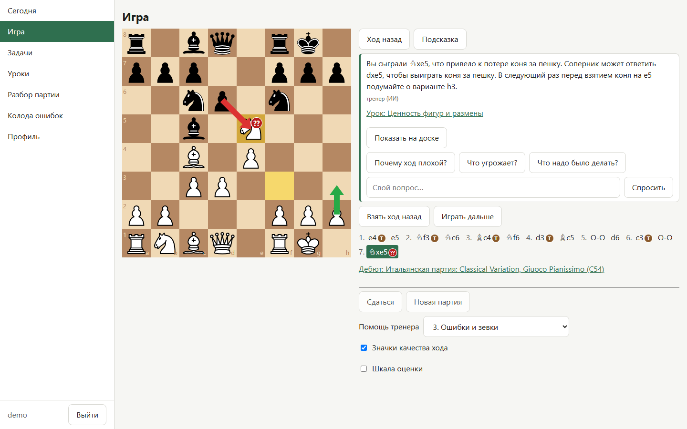
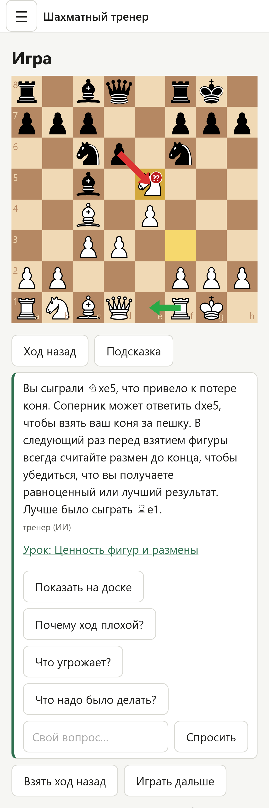
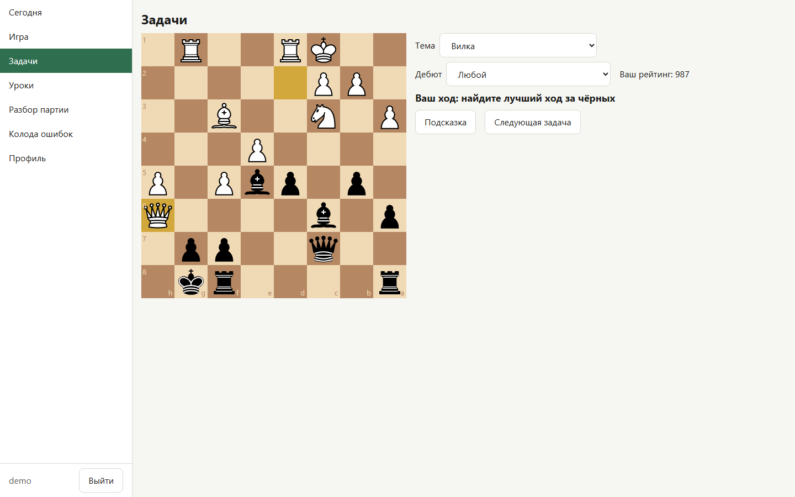
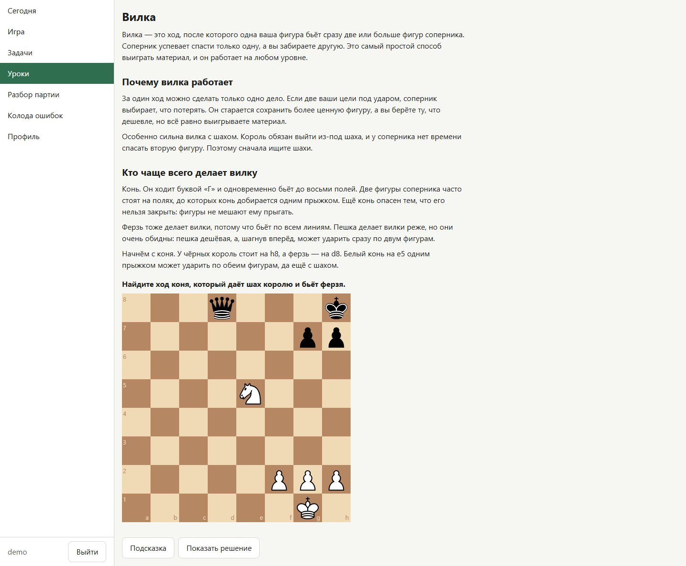
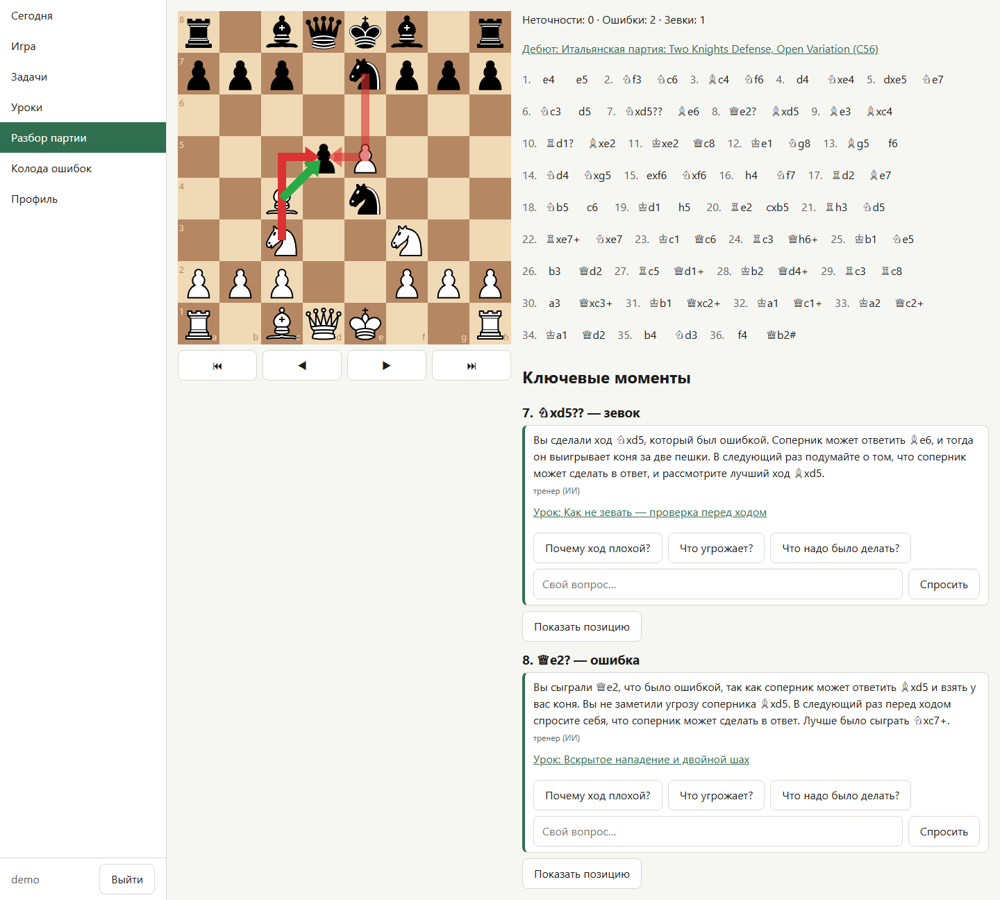
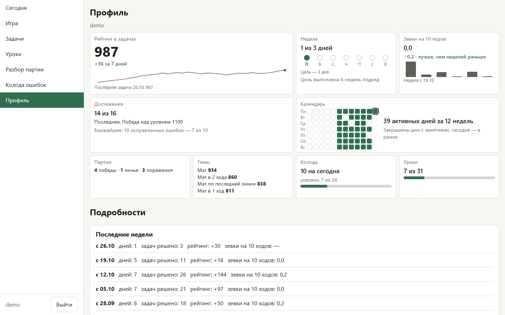
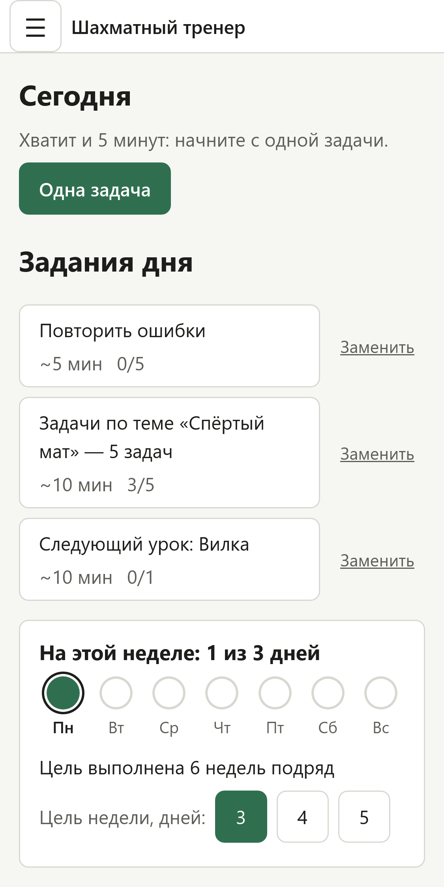
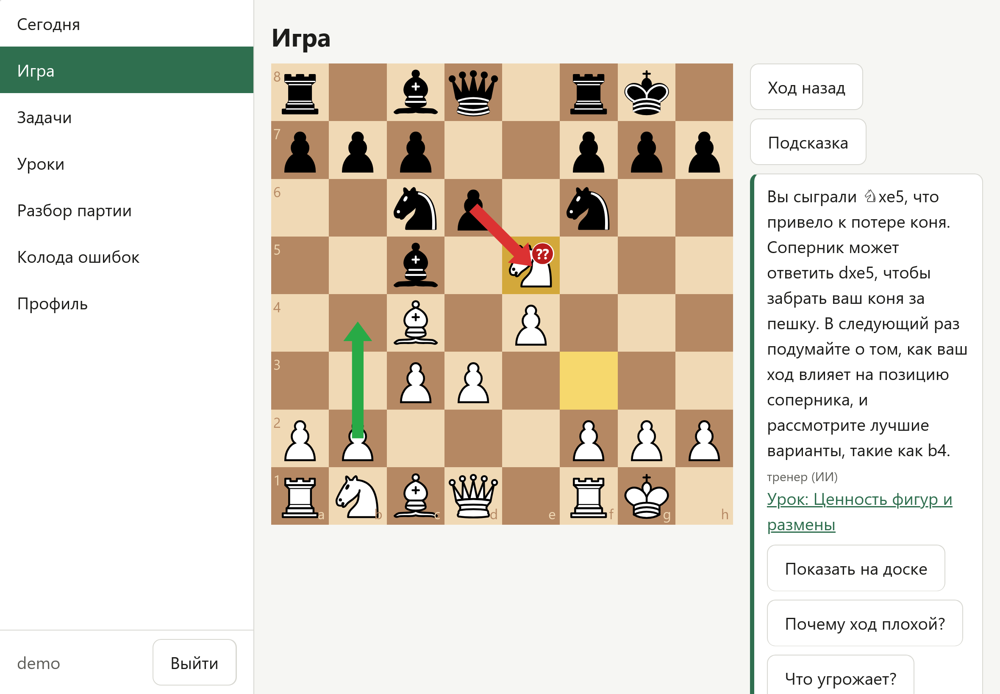

[English version](README.md)

# Шахматный тренер

Шахматный тренер — персональный тренер по шахматам для начинающего. Это веб-приложение, которое работает на вашем компьютере.
Оно работает без интернета в домашней сети, открывается в браузере компьютера, телефона или планшета.

**Язык.** Интерфейс и уроки пока на русском. Английский интерфейс запланирован.

<p>
  
  
</p>

## Содержание

- [Как это работает](#как-это-работает)
- [Возможности](#возможности)
- [Что нужно](#что-нужно)
- [Установка и запуск](#установка-и-запуск)
- [Первый пользователь](#первый-пользователь)
- [Настройки](#настройки)
- [LLM-тренер (необязательно)](#llm-тренер-необязательно)
- [Старший тренер через MCP (необязательно)](#старший-тренер-через-mcp-необязательно)
- [Телефоны и планшеты](#телефоны-и-планшеты)
- [Автозапуск](#автозапуск)
- [Безопасность](#безопасность)
- [Обновление и резервные копии](#обновление-и-резервные-копии)
- [Разработка](#разработка)
- [Благодарности и лицензии](#благодарности-и-лицензии)

## Как это работает

Шахматный движок считает, а языковая модель только объясняет.

- Все шахматные факты считают Stockfish и python-chess: оценку, лучший ход, вариант, висящую фигуру, тактический мотив.
- Приложение собирает факты в небольшой JSON и передаёт его локальной языковой модели (LLM).
  LLM пересказывает факты для новичка простыми словами, в двух–четырёх предложениях.
- Валидатор проверяет каждый ответ LLM. Если в тексте есть ход или поле, которых нет в фактах, приложение отклоняет текст и показывает шаблонное объяснение.
- Шаблонное объяснение есть для каждого типа фактов. Без LLM приложение работает полностью.

## Возможности

- **Сегодня.** Короткий план занятия: три задания дня с галочками, одно задание в день можно заменить.
  Цель недели — 3, 4 или 5 дней с занятиями. Кнопка «Одна задача» — для дней, когда мало времени.
  После перерыва в три дня и больше приложение встречает словами «С возвращением» без списка пропущенного.
- **Игра.** Вы играете с человекоподобным соперником: сети Maia через lc0, уровни от 800 до 1900.
  Уровень 800 — это Maia 1100, которая в четверти ходов делает случайный ход.
  У помощи тренера пять уровней: от «1. Без подсказок» до «5. Разбор каждого хода».
  Партия с возвратом хода или подсказкой тренера сохраняется как тренировочная: её результат не идёт в победы и поражения.
- **Задачи.** Около 350 000 задач из базы Lichess, рейтинг от 400 до 2400.
  Рейтинг Эло считается общий и по каждой теме. После ошибки тренер объясняет её и показывает решение.
- **Уроки.** 31 урок с интерактивными позициями: от ходов фигур до ладейных эндшпилей, и отдельный раздел о дебютах.
  Засчитывается и ход, который движок оценивает так же, как лучший, и любой мат.
- **Разбор партии.** Разбор сохранённой партии или вставленного PGN: пометки ?!, ? и ?? у ходов, до пяти ключевых моментов с объяснением.
  Нажатие на название дебюта открывает карточку дебюта с главной линией и задачами по нему.
- **Колода ошибок.** Зевки из партий, ошибки из разбора и проваленные задачи становятся карточками для интервального повторения.
  Каждый ответ проверяет движок. Карточка выучена после трёх правильных ответов подряд; в день — не больше 10 повторений.
- **Профиль.** График рейтинга в задачах, темы от слабых к сильным, зевки на 10 ходов, календарь занятий, 16 достижений и настройки.
- **Сравнение моделей.** Слепое сравнение объяснений LLM для администратора: два анонимных текста к одной ошибке и ваш голос.
  В таблице итогов любую модель можно сделать моделью по умолчанию.
- **Страница администратора.** Администратор создаёт пользователей, сбрасывает их токены, видит их прогресс и может отозвать их ключи MCP.
- **Старший тренер.** Языковая модель в MCP-клиенте, например в Claude Code, подключается к приложению.
  Она разбирает ваши партии через Stockfish приложения и сохраняет план для страницы «Сегодня».
  Модель может работать в облаке: см. раздел [Старший тренер через MCP](#старший-тренер-через-mcp-необязательно).

У каждого пользователя свой прогресс. Другие пользователи его не видят. Администратор видит сводку.

### Скриншоты

<table>
  <tr>
    <td></td>
    <td></td>
  </tr>
  <tr>
    <td></td>
    <td></td>
  </tr>
</table>

<table>
  <tr>
    <td></td>
    <td></td>
  </tr>
</table>

## Что нужно

- Windows или Linux.
- Python 3.11 или новее.
- Node.js 20.19+ или 22.12+ (фронтенд собирается Vite 8) и npm.
- git.
- На Linux: g++ и git, чтобы собрать lc0. Готовых сборок lc0 для Linux нет, поэтому `setup.py` собирает его из исходников (2–5 минут).
  Без lc0 соперником будет Stockfish с ограниченной силой.
- Место на диске: около 1,5 ГБ. Исходные файлы задач занимают около 850 МБ, база задач — около 135 МБ, движки — около 145 МБ,
  окружение Python — около 210 МБ, пакеты фронтенда — около 150 МБ.
  Каждая модель Ollama для LLM-тренера занимает ещё 2,7–6,6 ГБ. `setup.py --dev` дополнительно скачивает браузеры Playwright.
- Интернет нужен только для установки и обновления. Исключение — старший тренер с облачной моделью.
- Необязательно: видеокарта NVIDIA с 4–6 ГБ видеопамяти для LLM-тренера.

### Как поставить нужные программы

Windows:

```powershell
winget install Python.Python.3.12 Git.Git OpenJS.NodeJS.LTS
```

После установки откройте новый терминал.

Linux (Debian или Ubuntu): поставьте Python, git и g++ менеджером пакетов.

```bash
sudo apt install python3 python3-venv git g++
```

В Ubuntu 22.04 и старше — Python 3.10 или ещё старее. Поставьте Python 3.12 через uv, без прав администратора, и запускайте приложение с ним:

```bash
curl -LsSf https://astral.sh/uv/install.sh | sh
uv python install 3.12
PYTHON=python3.12 ./run.sh
```

Если оболочка не находит `python3.12`, выполните `uv python update-shell` и откройте новый терминал.

В apt у Debian 12 и Ubuntu 24.04 есть только Node.js 18, он слишком старый. Поставьте новый Node.js через nvm, без прав администратора:

1. Поставьте nvm:
   ```bash
   curl -o- https://raw.githubusercontent.com/nvm-sh/nvm/v0.40.8/install.sh | bash
   ```
2. Откройте новый терминал.
3. Поставьте Node.js 22:
   ```bash
   nvm install 22
   ```

## Установка и запуск

`setup.py` создаёт окружение Python в `.venv`, ставит пакеты, собирает фронтенд и скачивает:

- Stockfish (официальную сборку под вашу ОС и процессор);
- lc0 (готовую сборку на Windows, сборку из исходников на Linux);
- веса Maia от `maia-1100` до `maia-1900`;
- набор задач Lichess с зеркала на Hugging Face, затем импортирует отобранные задачи в `data/puzzles.db`;
- названия дебютов Lichess.

Повторный запуск не качает файлы заново.
Скрипты запуска `run.sh` и `run.ps1` вызывают `setup.py` при каждом запуске, пока он хотя бы раз не завершится успешно.

### Linux

1. Скачайте код и перейдите в папку проекта:
   ```bash
   git clone <repository-url> chess-coach
   cd chess-coach
   ```
2. Запустите приложение. Первый запуск вызывает `scripts/setup.py` и идёт долго:
   ```bash
   ./run.sh
   ```
   Если оболочка пишет «Permission denied», выполните `bash run.sh`.
3. Откройте в браузере `http://127.0.0.1:6355`. Откроется страница входа.
   Создайте первого пользователя, как описано в разделе [Первый пользователь](#первый-пользователь).
   Если приложение работает на другом компьютере, вместо `127.0.0.1` укажите адрес этого компьютера.

Чтобы остановить приложение, нажмите Ctrl+C в терминале.

### Windows

1. Скачайте код и перейдите в папку проекта:
   ```powershell
   git clone <repository-url> chess-coach
   cd chess-coach
   ```
2. Запустите приложение. Первый запуск вызывает `scripts/setup.py`:
   ```powershell
   .\run.ps1
   ```
   Если PowerShell не даёт запустить скрипт, используйте команду:
   ```powershell
   powershell -ExecutionPolicy Bypass -File run.ps1
   ```
3. Откройте в браузере `http://127.0.0.1:6355`. Откроется страница входа.
   Создайте первого пользователя, как описано в разделе [Первый пользователь](#первый-пользователь).
   Если приложение работает на другом компьютере, вместо `127.0.0.1` укажите адрес этого компьютера.

Чтобы остановить приложение, нажмите Ctrl+C в терминале.

### Команды вручную

Шаги можно выполнить без скриптов запуска. Первая установка идёт через системный Python:

```bash
python3 scripts/setup.py
```

```powershell
py -3 scripts\setup.py
```

Дальше используйте Python из `.venv`:

```bash
.venv/bin/python scripts/run.py
```

```powershell
.venv\Scripts\python.exe scripts\run.py
```

`run.py` собирает фронтенд и запускает сервер. С ключом `--no-build` сервер запускается без сборки.

`python3 scripts/preflight.py` (Linux) или `py -3 scripts\preflight.py` (Windows) проверяет окружение и показывает, чего не хватает.

### Если lc0 не собрался

На Linux `setup.py` продолжает работу без lc0, если сборка не удалась, и сам её не повторяет.

1. Поставьте g++ и git.
2. Соберите lc0:
   ```bash
   .venv/bin/python scripts/download_engines.py --only lc0
   ```
3. Перезапустите приложение.

### Если установку остановил лимит GitHub API

Скрипт скачивания движков `download_engines.py` обращается к GitHub API, который без токена отвечает на 60 запросов в час.
Если установка упала из-за этого лимита, подождите час или запустите её с личным токеном GitHub:

```bash
GITHUB_TOKEN=<токен> ./run.sh
```

```powershell
$env:GITHUB_TOKEN = "<токен>"; .\run.ps1
```

Скрипт отправляет токен только на `api.github.com`.

## Первый пользователь

Открытой регистрации нет. Каждого пользователя создаёт администратор на своей странице.

1. `setup.py` записывает случайный `ADMIN_TOKEN` в файл `.env` в папке проекта. На экран токен не выводится.
   Если задаёте токен сами, берите не меньше 20 символов.
2. Откройте `.env` и скопируйте значение `ADMIN_TOKEN`.
3. Откройте `http://127.0.0.1:6355/admin` и введите токен администратора.
4. В блоке «Создать пользователя» введите логин и нажмите кнопку.
   Логин — от 2 до 32 символов: строчные латинские буквы, цифры, `_`, `.` и `-`.
5. Приложение один раз показывает токен пользователя. Сохраните его сразу: приложение хранит только хэш.
6. Откройте `http://127.0.0.1:6355` и войдите с логином и токеном пользователя.

Если пользователь потерял токен, нажмите «Сбросить токен» на странице администратора, затем «Да, сбросить».
Старый токен и все сессии этого пользователя сразу перестают работать.

Кнопки «Скопировать» не работают по обычному HTTP с сетевого адреса вроде `http://192.168.x.x:6355`.
Браузер даёт доступ к буферу обмена только на защищённой странице. В этом случае выделите текст и скопируйте его вручную.

Файл `.env` указан в `.gitignore`. Не коммитьте его и никому не отправляйте.

## Настройки

Приложение берёт настройки из переменных окружения и из файла `.env` в папке проекта.
Переменная окружения важнее `.env`. Основные переменные показаны в `.env.example`.
После изменения перезапустите приложение.

| Переменная | По умолчанию | Что задаёт |
|---|---|---|
| `APP_HOST` | `0.0.0.0` | Адрес, на котором слушает сервер. |
| `APP_PORT` | `6355` | Порт приложения. |
| `ADMIN_TOKEN` | пусто | Токен для `/admin`, не меньше 20 символов. Его создаёт `setup.py`. Без него страница администратора закрыта. |
| `LLM_ENABLED` | `true` | `false` выключает LLM; приложение показывает шаблонные объяснения. |
| `LLM_BASE_URL` | `http://localhost:11434` | Адрес сервера Ollama. |
| `LLM_MODEL` | `gemma4:e2b` | Модель по умолчанию. Модель, выбранная в «Сравнении моделей», важнее. |
| `LLM_TIMEOUT_S` | `20` | Сколько секунд ждать ответ LLM. Потом приложение показывает шаблон. |
| `COOKIE_SECURE` | `false`, с сертификатом `true` | Отправлять cookie только по HTTPS. |
| `APP_SSL_CERTFILE` | пусто | Путь к сертификату (PEM). Вместе с ключом сервер работает по HTTPS. |
| `APP_SSL_KEYFILE` | пусто | Путь к закрытому ключу (PEM). |
| `TRUST_PROXY` | `false` | `true`, если перед приложением стоит ваш обратный прокси: адрес клиента берётся из `X-Forwarded-For`. |
| `ENGINE_REQUESTS_PER_USER` | `3` | Сколько запросов к движку одного пользователя идёт одновременно. Остальные ждут до 10 секунд. |
| `STOCKFISH_THREADS` | `4` | Потоки Stockfish. |
| `STOCKFISH_HASH` | `256` | Хэш Stockfish в МБ. |
| `ENGINE_POOL_SIZE` | `2` | Число процессов Stockfish в пуле. |
| `ANALYSIS_MOVETIME_MS` | `500` | Лимит времени на один анализ, в миллисекундах. |
| `COACH_DEPTH` | `14` | Глубина расчёта для тренера после хода. |
| `REVIEW_DEPTH` | `12` | Глубина расчёта для разбора партии. |
| `COACH_INACCURACY` | `0.10` | Порог неточности: насколько упал шанс на победу после хода. |
| `COACH_MISTAKE` | `0.20` | Порог ошибки. |
| `COACH_BLUNDER` | `0.30` | Порог зевка. |
| `APP_DATA_DIR` | `data` | Папка с базами данных. |
| `APP_DB_PATH` | `app.db` в `APP_DATA_DIR` | База с пользователями и прогрессом. |
| `PUZZLES_DB_PATH` | `puzzles.db` в `APP_DATA_DIR` | База задач. |
| `ENGINES_DIR` | `engines` | Папка со Stockfish, lc0 и Maia. |
| `FRONTEND_DIST` | `frontend/dist` | Собранный фронтенд. |
| `LESSONS_DIR` | `content/lessons` | Файлы уроков. |
| `APP_VERSION` | `dev` | Текст версии. |

`setup.py` всегда пишет в `data/` и `engines/`.
Если вы меняете `APP_DATA_DIR` или `ENGINES_DIR`, перенесите файлы в новую папку сами.

## LLM-тренер (необязательно)

LLM-тренер превращает факты от движка в короткие объяснения простыми словами. Он работает локально через [Ollama](https://ollama.com).
Без Ollama приложение показывает шаблонные объяснения, и все функции работают.

1. Поставьте Ollama.
   - Windows:
     ```powershell
     winget install Ollama.Ollama
     ```
   - Linux:
     ```bash
     curl -fsSL https://ollama.com/install.sh | sh
     ```
2. Скачайте модель по умолчанию:
   ```bash
   ollama pull gemma4:e2b
   ```
3. Запустите приложение. Оно подключается к `http://localhost:11434`.

Мы проверили четыре модели. Все они помещаются в 6 ГБ видеопамяти.
Видеопамять мы мерили через `nvidia-smi` до и после загрузки модели, при контексте 4096 токенов.

| Модель | Размер файла | Видеопамять |
|---|---|---|
| `gemma4:e4b` (q4_K_M) | 6,6 ГБ | 4,8 ГБ |
| `qwen3.5:4b` | 3,3 ГБ | 3,9 ГБ |
| `gemma4:e2b` | 4,6 ГБ | 3,2 ГБ |
| `qwen3.5:2b` | 2,7 ГБ | 3,2 ГБ |

Как выбрать модель:

1. Скачайте модели для сравнения: `ollama pull <модель>`.
2. Убедитесь, что Ollama работает. Подготовьте объяснения для сравнения. Укажите через запятую только скачанные модели:
   ```bash
   .venv/bin/python scripts/bench_models.py --models gemma4:e2b,qwen3.5:2b
   ```
   ```powershell
   .venv\Scripts\python.exe scripts\bench_models.py --models gemma4:e2b,qwen3.5:2b
   ```
   На каждую модель уходит несколько минут. Результаты попадают в `data/bench/`.
3. На странице администратора откройте «Сравнение моделей». Эта страница доступна только администратору.
4. Голосуйте за лучшее объяснение в каждой паре. Тексты анонимные.
5. В таблице итогов нажмите «Сделать моделью по умолчанию».
   Кнопка есть в каждой строке, кроме строки текущей модели по умолчанию.

Приложение хранит этот выбор в своей базе. Он важнее `LLM_MODEL`.

Чтобы выключить LLM, поставьте `LLM_ENABLED=false` в `.env` и перезапустите приложение.

## Старший тренер через MCP (необязательно)

Старший тренер — языковая модель в MCP-клиенте, например в Claude Code.
Он читает ваши партии и прогресс, разбирает партии через Stockfish приложения и сохраняет план занятий.
План появляется на странице «Сегодня», и задания дня идут по нему.

Клиент работает на вашем компьютере, но сама модель может работать в облаке.
Тогда ваши партии и прогресс уходят поставщику модели, а клиенту нужен интернет.

### Создать ключ

1. Войдите и откройте «Профиль», раздел «Настройки».
2. В блоке «Старший тренер (MCP)» нажмите «Создать ключ».
3. Сразу скопируйте ключ. Приложение показывает его один раз и хранит только хэш.

«Заменить ключ» создаёт новый ключ, а старый перестаёт работать. «Удалить ключ» удаляет ключ.
Потерянный ключ не восстановить: создайте новый.
Сброс токена не отзывает ключ MCP. Чтобы полностью закрыть доступ пользователю, администратор нажимает и «Отозвать ключ» на своей странице.

### Подключить клиент

- Адрес: `http://<адрес-сервера>:6355/mcp` (MCP Streamable HTTP, запросы POST).
- Авторизация: HTTP-заголовок `Authorization: Bearer <ключ>`.

Блок «Как подключить» в настройках показывает готовую команду для Claude Code:

```bash
claude mcp add --scope user --transport http chess http://<адрес-сервера>:6355/mcp --header "Authorization: Bearer <ключ>"
```

С `--scope user` сервер доступен в любой папке, где вы запускаете Claude Code.

Подойдёт и другой MCP-клиент, если он поддерживает транспорт Streamable HTTP и свой заголовок запроса.
Многие клиенты используют JSON-конфигурацию такого вида. Названия полей у разных клиентов могут отличаться.

```json
{
  "mcpServers": {
    "chess": {
      "type": "http",
      "url": "http://<адрес-сервера>:6355/mcp",
      "headers": { "Authorization": "Bearer <ключ>" }
    }
  }
}
```

### Инструменты

| Инструмент | Что делает |
|---|---|
| `get_profile` | Профиль игрока: партии, дебюты, колода ошибок, рейтинг задач по темам, уроки, активность, текущий план и допустимые значения для `save_plan`. |
| `list_games` | Последние партии: дата, цвет, уровень, результат, дебют, возвраты ходов и подсказки. |
| `review_game` | Разбор одной партии через Stockfish: плохие ходы и ключевые моменты с лучшим ходом и вариантом. |
| `analyse_position` | Анализ позиции FEN через Stockfish: до трёх вариантов, оценка словами. |
| `get_plan` | Последний сохранённый план. |
| `save_plan` | Сохраняет новый план: короткая сводка, до 3 тем, до 6 уроков и до 3 дебютов. |

У сервера есть и MCP-промпт `weekly_review`. Он ведёт модель по шагам: профиль, разбор последних партий, слабые места, план.
Модель не может сама запустить промпт, его запускаете вы.
В Claude Code введите `/mcp__chess__weekly_review`. Другие клиенты показывают MCP-промпты в своём меню.

Примеры запросов к модели:

- «Разбери три мои последние партии и скажи, какую ошибку я делаю чаще всего».
- «Какие темы задач у меня самые слабые? Сохрани план на эту неделю».

### Что старший тренер может и чего не может

- Он читает только данные владельца ключа.
- Все шахматные факты он берёт из `review_game` и `analyse_position`, то есть из Stockfish.
- Записать он может только новый план через `save_plan`. Старые планы остаются в базе.
- Он принимает только темы, уроки и дебюты из списка в `get_profile`. Другие значения сервер отклоняет.
- Он не может делать ходы, менять рейтинг, удалять партии и видеть других пользователей.

## Телефоны и планшеты

Вёрстка работает на телефонах и планшетах в книжной и альбомной ориентации.
Чтобы сделать ход, коснитесь фигуры, затем поля, куда она идёт. Фигуру можно и перетащить.

1. Подключите устройство к той же сети Wi-Fi, что и компьютер с приложением.
2. Узнайте адрес компьютера.
   - Windows: выполните `ipconfig` и найдите строку «IPv4-адрес».
   - Linux: выполните `hostname -I`.
3. На устройстве откройте `http://<адрес-компьютера>:6355`.

Если страница не открывается, разрешите порт в файрволе. Команду выполняйте от имени администратора.

- Windows, PowerShell:
  ```powershell
  New-NetFirewallRule -DisplayName "ChessCoach" -Direction Inbound -Protocol TCP -LocalPort 6355 -Action Allow -Profile Private
  ```
  Это правило работает, только если сеть Wi-Fi частная.
  Проверьте: «Параметры» → «Сеть и Интернет» → «Wi-Fi» → ваша сеть, выберите «Частная сеть».
  Если в окне брандмауэра Защитника Windows для `python.exe` вы нажали «Отмена», откройте «Разрешение взаимодействия с приложением через брандмауэр» и разрешите `python.exe` для частных сетей.
- Linux с ufw:
  ```bash
  sudo ufw allow 6355/tcp
  ```

## Автозапуск

Фронтенд собирает `setup.py`, поэтому автозапуск вызывает `run.py --no-build`.

### Linux: systemd

Файл `deploy/chess-coach.service` — пример юнита. Замените `USER` на имя своего пользователя.
Если проект лежит не в `/home/USER/chess-coach`, поправьте и пути.

Пользовательский юнит:

1. Скопируйте файл в `~/.config/systemd/user/chess-coach.service`.
2. Включите и запустите службу:
   ```bash
   systemctl --user daemon-reload
   systemctl --user enable --now chess-coach
   ```
3. Чтобы служба запускалась без входа в систему, выполните:
   ```bash
   sudo loginctl enable-linger USER
   ```

Системный юнит:

1. Скопируйте файл в `/etc/systemd/system/chess-coach.service`.
2. Уберите `#` перед `User=USER` и замените `WantedBy=default.target` на `WantedBy=multi-user.target`.
3. Включите и запустите службу:
   ```bash
   sudo systemctl daemon-reload
   sudo systemctl enable --now chess-coach
   ```

Логи: `journalctl --user -u chess-coach -f` (для системного юнита — без `--user`).

### Windows: Планировщик задач

Задача запускает приложение, когда вы входите в Windows. Windows может запросить права администратора.
При входе может открыться окно консоли; если его закрыть, приложение остановится.

1. Откройте PowerShell в папке проекта и выполните:
   ```powershell
   $dir = (Get-Location).Path
   $action = New-ScheduledTaskAction -Execute "cmd.exe" -Argument "/c .venv\Scripts\python.exe scripts\run.py --no-build >> data\app.log 2>&1" -WorkingDirectory $dir
   $trigger = New-ScheduledTaskTrigger -AtLogOn -User $env:USERNAME
   $settings = New-ScheduledTaskSettingsSet -ExecutionTimeLimit ([TimeSpan]::Zero) -AllowStartIfOnBatteries -DontStopIfGoingOnBatteries
   Register-ScheduledTask -TaskName "ChessCoach" -Action $action -Trigger $trigger -Settings $settings
   ```
2. Чтобы запустить задачу сейчас:
   ```powershell
   Start-ScheduledTask -TaskName "ChessCoach"
   ```

Чтобы остановить приложение, остановите задачу, а затем процесс, который слушает порт 6355:

```powershell
Stop-ScheduledTask -TaskName "ChessCoach"
Get-NetTCPConnection -LocalPort 6355 -State Listen -ErrorAction SilentlyContinue | ForEach-Object { Stop-Process -Id $_.OwningProcess }
```

Чтобы удалить задачу:

```powershell
Unregister-ScheduledTask -TaskName "ChessCoach" -Confirm:$false
```

Лог лежит в `data\app.log`.

## Безопасность

Приложение сделано для домашней сети.

- В домашней сети приложение работает по обычному HTTP. Любой в той же сети может увидеть токены и cookie.
  Пользуйтесь приложением только в сети, которой доверяете, а не в общественном Wi-Fi.
- Каждый пользователь входит по логину и токену. Приложение хранит только хэши токенов, сессий и ключей MCP.
- Попытки входа ограничены для каждого IP-адреса: после 5 неверных попыток за 15 минут вход блокируется, пока самой старой попытке не исполнится 15 минут.
  Неверные токены администратора и пользователей считаются вместе. У неверных ключей MCP свой счётчик с теми же числами.
  Счётчики обнуляются при перезапуске приложения.
- Cookie с флагами `HttpOnly` и `SameSite=Strict`. Приложение проверяет заголовок `Origin` и отправляет заголовки безопасности с Content Security Policy.
- Тело запроса — не больше 1 МБ.
- Держите `.env` в секрете: в нём `ADMIN_TOKEN`.

Не открывайте порт 6355 в интернет по обычному HTTP.
Для доступа снаружи используйте VPN, например Tailscale, или HTTPS одним из двух способов:

- **Свой сертификат.** Задайте `APP_SSL_CERTFILE` и `APP_SSL_KEYFILE` в `.env`. `run.py` передаёт их в uvicorn.
  `COOKIE_SECURE` становится `true`, если в `.env` его нет. Если вы сами поставили `COOKIE_SECURE=false`, он остаётся `false`.
- **Обратный прокси** с HTTPS, например Caddy или nginx. Задайте в `.env` `APP_HOST=127.0.0.1`, `TRUST_PROXY=true` и `COOKIE_SECURE=true`.
  Прокси должен передавать исходный заголовок `Host` и ставить `X-Forwarded-For` и `X-Forwarded-Proto`: приложение сравнивает `Origin` с `Host`.
  Caddy делает это по умолчанию. Для nginx добавьте в блок `location` строки:
  ```nginx
  proxy_set_header Host $host;
  proxy_set_header X-Forwarded-For $proxy_add_x_forwarded_for;
  proxy_set_header X-Forwarded-Proto $scheme;
  ```

Не открывайте в сеть порт Ollama 11434. Приложение обращается к Ollama через `localhost`.

Уроки — это файлы Markdown, которые приложение показывает как HTML без очистки. Добавляйте уроки только из источников, которым доверяете.

## Обновление и резервные копии

1. Остановите приложение.
2. Скачайте новый код:
   ```bash
   git pull
   ```
3. Поставьте новые пакеты и соберите фронтенд через Python из `.venv`:
   ```bash
   .venv/bin/python scripts/setup.py
   ```
   ```powershell
   .venv\Scripts\python.exe scripts\setup.py
   ```
4. Запустите приложение.

База `data/app.db` хранит всех пользователей и их прогресс.
При каждом запуске сервер сначала копирует базу в `data/backups/` и хранит последние 7 копий.

Как восстановить копию:

1. Остановите приложение.
2. Скопируйте файл из `data/backups/` поверх `data/app.db`.
3. Запустите приложение.

Копии лежат на том же диске, что и база. Время от времени останавливайте приложение и копируйте `data/app.db` на другой диск.

Чтобы перенести приложение на другой компьютер, скопируйте `data/app.db` вместе с кодом. Остальное `setup.py` скачает заново.

## Разработка

1. Поставьте инструменты разработки и браузеры Playwright:
   ```bash
   .venv/bin/python scripts/setup.py --dev
   ```
   ```powershell
   .venv\Scripts\python.exe scripts\setup.py --dev
   ```
   На Linux для WebKit нужны ещё системные библиотеки:
   ```bash
   cd frontend && npx playwright install-deps webkit
   ```
   Пароль sudo Playwright спросит сам.
2. Запустите все проверки:
   ```bash
   .venv/bin/python scripts/check.py
   ```
   ```powershell
   .venv\Scripts\python.exe scripts\check.py
   ```

`check.py` запускает ruff (проверка и формат), pytest для бэкенда, проверку типов TypeScript, eslint, vitest, сборку фронтенда и e2e-тесты Playwright.
E2E-тесты идут в настольном Chromium и в профилях iPhone 13 Mini, iPad (gen 11) и iPad (gen 11) landscape.
Последняя строка вывода — `CHECK: PASS` или `CHECK: FAIL (...)`.

Структура проекта:

- `backend/` — сервер FastAPI, тренер, движки, задачи, уроки, разбор, колода ошибок, сервер MCP; тесты в `backend/tests/`.
- `frontend/` — Vite, React и TypeScript, chess.js и react-chessboard.
- `content/lessons/` — уроки в Markdown с интерактивными позициями.
- `scripts/` — скрипты установки, запуска, скачивания и проверки на Python.
- `deploy/` — пример юнита systemd.

## Благодарности и лицензии

Шахматный тренер — свободная программа под лицензией GNU General Public License версии 3 или любой более поздней версии (GPL-3.0-or-later). Текст — в файле [LICENSE](LICENSE).

Приложение использует эти проекты и данные:

| Проект | Для чего | Лицензия |
|---|---|---|
| [Stockfish](https://github.com/official-stockfish/Stockfish) | Движок для анализа | GPL-3.0 |
| [lc0](https://github.com/LeelaChessZero/lc0) | Запускает сети Maia | GPL-3.0 |
| [Maia](https://github.com/CSSLab/maia-chess) (CSSLab) | Веса человекоподобного соперника | GPL-3.0 |
| [python-chess](https://github.com/niklasf/python-chess) | Шахматные правила и управление движками | GPL-3.0+ |
| [Задачи Lichess](https://huggingface.co/datasets/Lichess/chess-puzzles) | Набор задач | CC0 |
| [lichess-org/chess-openings](https://github.com/lichess-org/chess-openings) | Названия дебютов | CC0 |
| [chess.js](https://github.com/jhlywa/chess.js) | Шахматные правила в браузере | BSD-2-Clause |
| [react-chessboard](https://github.com/Clariity/react-chessboard) | Компонент доски | MIT |

Остальные пакеты перечислены в `requirements.txt` и `frontend/package.json`, у каждого своя лицензия.

Движков, весов и задач в этом репозитории нет. `setup.py` скачивает их из первоисточников.
